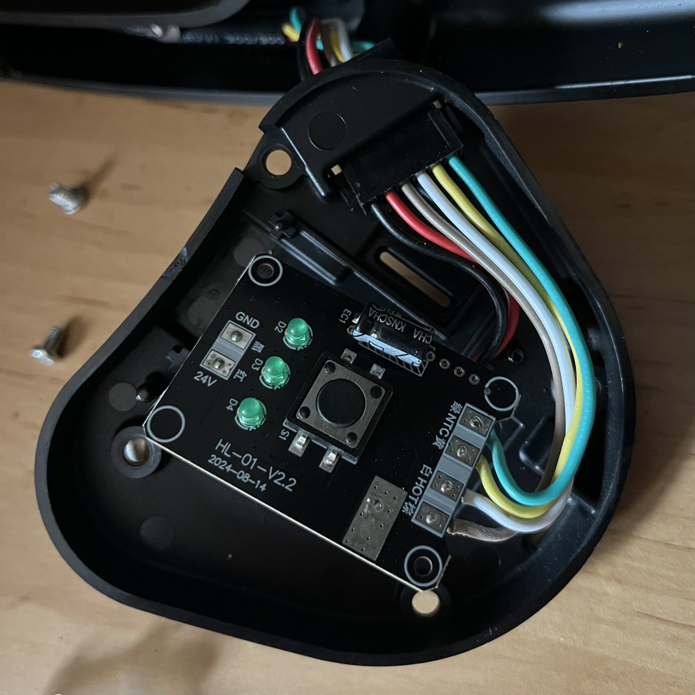
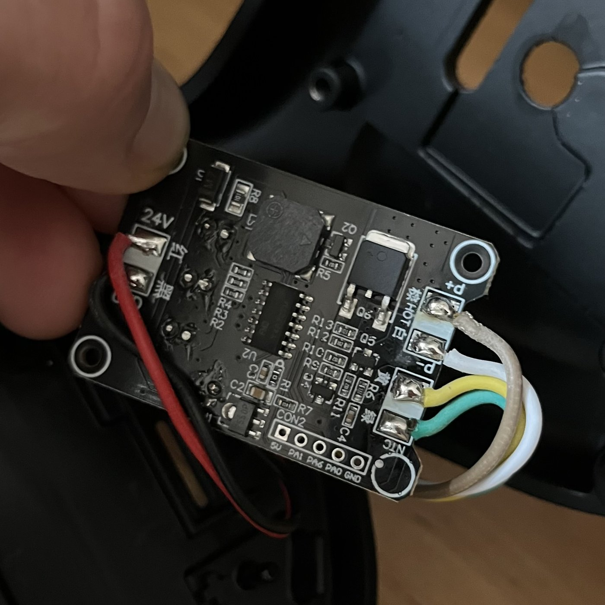

# Smart Flair 58

A write-up of one build that makes a **Flair 58** lever espresso machine smart with an ESP32 and
[ESPHome](https://esphome.io), optionally coupled to a **Fellow Stagg EKG Pro** kettle: switch one on and both heat,
switch one off and both go off.

The original Flair firmware stays in charge of heating. The ESP presses the button and reads the three status LEDs;
it does not touch the heater or the temperature sensor.

> Unofficial, not affiliated with Flair Espresso or Fellow. Opening the machine voids its warranty. This repo
> documents what was measured and built on one machine and is provided as is, without any warranty.

**Contents:** [Features](#features) · [Status](#status) · [How it works](#how-it-works) ·
[The board in short](#the-board-in-short) · [Parts](#parts) · [Wiring](#wiring) · [Firmware](#firmware) ·
[Kettle](#kettle) · [Home Assistant](#home-assistant) · [Further reading](#further-reading)

## Features

| Feature | Needs |
|---|---|
| Flair on/off, preset (LOW/MEDIUM/HIGH) and status (`off` / `heating` / `ready`) in Home Assistant | base |
| Safety off after 45 min on the ESP, independent of Home Assistant | base |
| "Start on HIGH": the Flair always starts on LOW, the ESP steps it to HIGH | base |
| One short press on the real button while off = switch on (the stock firmware ignores it) | base + button read |
| Kettle on → Flair on; Flair on → kettle heats to a target; either off → both off | kettle package |
| Auto off ~25 s after the shot (heuristic, opt-in) | auto_off package |
| Melodies on the kettle buzzer (triple press, auto-off jingle) | kettle package |
| "Espresso ready" notification when head and water are at temperature | Home Assistant examples |

There is no brew head temperature: tapping the Flair's NTC disturbed its own measurement (see
[The board in short](#the-board-in-short)), so "ready" comes from the LEDs, the same thing you see on the machine.

## Status

Running on one machine since October 2026: board **HL-01-V2.2**, ESP32-C3 + D4184 MOSFET module, kettle firmware
1.1.75SSP. Tested end to end: Flair ↔ kettle in both directions, auto off in a real shot. Not yet verified, other board
revisions and kettle firmware versions included: [docs/ideas.md](docs/ideas.md#open-points).

## How it works

```
                     ┌──────────────────────────────┐
 24 V PSU ──┬───────▶│ Flair board                   │── heater (Q6, high side)
            │        │ U2 = stock MCU and firmware   │── NTC (not tapped)
            │        └───┬──────────────┬───────────┘
            │   S1 leg on U2 pin 4      │ LED anodes (~2.2 V lit)
            │   (active-low, 5 V idle)  │
            │      │         │          │
            │   MOSFET    100 kΩ        │
            │   (press)   (read)        │
            │      │         │          │
         buck   ┌──▼─────────▼──────────▼──────┐
       24 → 5 V │ ESP32-C3 (ESPHome)            │── Wi-Fi ──▶ Home Assistant
            └──▶│                               │── Wi-Fi ──▶ kettle (HTTP CLI)
                └──────────────────────────────┘
```

- **Press:** a MOSFET pulls the button line to GND. 1300 ms = on/off, 50 ms = next preset.
- **Read:** the LEDs go into ADC pins. Blinking = heating, solid bar = ready.
- **Verify:** the button only toggles, so every power change is checked against the LEDs afterwards.

## The board in short

Measured on board HL-01-V2.2 (2024-08-14). Details and component list: [docs/hardware.md](docs/hardware.md).

<p>
  <a href="photos/board-front.jpg"></a>
  <a href="photos/board-back.jpg"></a>
</p>

| Topic | Finding |
|---|---|
| Supply | external 24 V PSU, no mains inside. 5 V logic from a 7550-type LDO (~100 mA) |
| Button S1 | active-low on U2 pin 4: idles at 5 V, pressed = 0 V. A short press while off is ignored by the Flair |
| LEDs | cathodes on GND, anode ≈ 2.2 V when lit. Below a guaranteed ESP32 digital high, so read via ADC1 |
| LED logic | heating = preset LED blinks (~1 s), ready = solid bar (LOW: 1, MEDIUM: 2, HIGH: 3 LEDs). Power-on starts on LOW |
| NTC | pulsed by U2, very high impedance. An ESP pin on it (even through 3 kΩ) made the LEDs flicker; a loose wire on the pad changed the reading when touched |
| CON2 header | factory programming header (`5V PA1 PA6 PA0 GND`), no UART, no control path |

### Design choices in this build

| Choice | Reason |
|---|---|
| LEDs instead of the NTC | the NTC tap disturbed the Flair's own temperature reading |
| MOSFET instead of a direct GPIO | a direct GPIO sees the Flair's 5 V pull-up, and an unpowered ESP pulled the line low through its clamp diodes (phantom press at power-up) |
| One common supply (buck from 24 V) | ESP powered while the Flair was not (or the other way round) back-fed through the signal wires and disturbed the Flair |
| No switch in the Flair's GND | a low-side cut breaks the common ground and back-feeds through the signal wires. A hard power cut would go in the +24 V line |
| Not from CON2 `5V` | that is the small LDO, not enough for an ESP32 with Wi-Fi |

## Parts

| Part | Notes |
|---|---|
| ESP32-C3 board, ideally with external antenna | reference: DIYMall ESP32-C3 MINI V1. A C3 SuperMini fits too; its PCB antenna is weak. Needs 3 free ADC1 pins |
| MOSFET for the button | reference: D4184 module. Smaller alternative: 2N7002 or BSS138 with 100 kΩ gate → GND (untested here) |
| Buck 24 V → 5 V, ≥ 30 V input rating | Pololu D24V5F5 (5.1–36 V) or Traco TSR 0.5-2450 (6.5–32 V). Mini-360 is rated 23 V max, MP1584 28 V |
| Electrolytic ≥ 33 µF / ≥ 50 V | at the buck input, against plug-in spikes |
| Polyfuse 250–500 mA, V_max ≥ 30 V | in the 24 V tap. Many 1206 polyfuses are rated 6–16 V only |
| Resistors | 100 kΩ for the button read; 3 × 10 kΩ for the LED lines (recommended, untested here) |
| Silicone wire 26–28 AWG, heat-shrink, Kapton tape | it gets warm inside the housing |

## Wiring

Board photos: [The board in short](#the-board-in-short).

### Button press (MOSFET)

| From | To |
|---|---|
| ESP GPIO10 | MOSFET gate (D4184 module: TRIG/PWM) |
| ESP GND | module GND |
| MOSFET source (module VIN−) | Flair GND |
| MOSFET drain (module VOUT−) | S1 leg on U2 pin 4 |

GPIO high = MOSFET conducts = pressed. An unpowered ESP leaves the MOSFET off. If nothing switches: TRIG and GND on
the D4184 module are easy to swap.

### Status LEDs

| Flair LED | ESP32-C3 |
|---|---|
| left (LOW) | GPIO4 (ADC1) |
| middle (MEDIUM) | GPIO1 (ADC1) |
| right (HIGH) | GPIO0 (ADC1) |

Tap the anode leg (the one without continuity to GND). The reference build connects them directly; a 10 kΩ in each
line would protect both sides against a slip of the soldering iron. If the order comes out wrong, swap the pins in
the config, not the wires.

### Real-button read (optional)

S1 leg on U2 pin 4 → **100 kΩ** → ESP GPIO6, then set `pin_button_read_pullup: "false"` in the config.

The line idles at 5 V, so GPIO6 sits on the ESP's clamp diode (~14 µA). With much less than 100 kΩ, an unpowered ESP
could load pin 4 enough to look like a press. A resistor of 150–220 kΩ from GPIO6 to GND would make it a clean divider
(untested here: check that the idle level stays above ~2.6 V).

Without the wire, keep the default `"true"`: a floating pin produces phantom clicks, and one click while off switches
the Flair on.

### Supply

Flair 24V pad → polyfuse → buck VIN (capacitor at VIN–GND); Flair GND → buck GND and ESP GND; buck 5 V → ESP 5V pin.
Connecting USB while the buck feeds the 5V pin can back-feed one into the other; check whether your board has a diode
between VBUS and 5V.

The reference build still runs the ESP from USB. Powering the ESP and the Flair from the same switched outlet avoids
the one-side-unpowered case described above.

### Other boards

| Board | Button (MOSFET) | Button read | LEDs (ADC1) | Status |
|---|---|---|---|---|
| ESP32-C3 | GPIO10 | GPIO6 | GPIO4, GPIO1, GPIO0 | reference build |
| ESP32 classic (`esp32dev`) | GPIO26 | – | GPIO32, GPIO33, GPIO35 | earlier build with direct open-drain drive and read-back on GPIO26 |

LEDs need ADC1 (ADC2 does not work while Wi-Fi is on). Strapping pins: C3 GPIO2/8/9, classic GPIO0/2/5/12/15. Only
`esp32: board:` and the pin substitutions are board-specific.

### Bring-up order

1. Buck, capacitor and fuse on the bench; measure 5 V before the ESP sees it.
2. Flash the ESP over USB on the bench.
3. LED taps: `LED n voltage` in Home Assistant should read ≈ 2.2 V lit, ≈ 0 V off.
4. MOSFET: with the machine on, `Next preset` steps the preset; then try `Power toggle`.
5. Optional button read: `Button line (raw)` follows the real button; set the pull-up substitution to `"false"`.
6. Insulate, fix the boards, put the antenna against a plastic wall, close the housing.

The machine is a poor place for an antenna (the reference C3 sees −69…−73 dBm). An external antenna routed outside
the board cavity helps; on a flaky C3 SuperMini, `wifi: output_power: 8.5dB` is a common fix.

## Firmware

| File | Content |
|---|---|
| [`esphome/flair58.yaml`](esphome/flair58.yaml) | main config: presses, LED decoding, state, safety off, Start on HIGH, click handling |
| [`esphome/packages/kettle_wifi.yaml`](esphome/packages/kettle_wifi.yaml) | optional: kettle coupling over Wi-Fi, melodies |
| [`esphome/packages/auto_off.yaml`](esphome/packages/auto_off.yaml) | optional: auto off after the shot |

```bash
cp esphome/secrets.example.yaml esphome/secrets.yaml   # fill it in
# edit esphome/flair58.yaml: pins, pin_button_read_pullup, packages you want
esphome run esphome/flair58.yaml                       # first time over USB
esphome run esphome/flair58.yaml --device <ip>         # later over Wi-Fi
```

The main config compiles without the packages; delete the lines under `packages:` you do not want. Building on a
computer is much faster than in the Home Assistant ESPHome add-on.

| Switch | Default | Effect |
|---|---|---|
| `Start on HIGH` | off | two short presses after every power-on |
| `Short press starts` | on | one click on the real button while off = on |
| `Kettle sync` | on | the coupling (kettle package) |
| `Melody on triple press` | on | ≥ 3 clicks while off = melody on the kettle |
| `Auto off after shot` | off | off ~25 s after the first reheat following Ready |
| `Auto off jingle` | on | 1 s jingle on the kettle before auto off (needs both packages) |

Behaviour table, entities, events, timings and the reasons behind the odd parts: [docs/firmware.md](docs/firmware.md).

## Kettle

The coupling talks to the **Fellow Stagg EKG Pro** over its local HTTP CLI, which only exists on older firmware:

| Firmware | Local CLI | Works with `kettle_wifi.yaml` |
|---|---|---|
| 1.1.75SSP / 1.1.76SSP | yes | yes (1.1.75SSP tested) |
| 1.2.24 | muted | no |
| 1.2.26 | muted, on/off via BLE only | no; see the HA coupling below |

Once the kettle has internet access it updates itself, and opening the Fellow app also triggers an update. The tested
kettle stays on 1.1.75SSP on an SSID without internet access. The HA integration
[bramboe/stagg-ekg-plus-ha](https://github.com/bramboe/stagg-ekg-plus-ha) can block updates and, in its beta, switch
firmware.

Give the kettle a fixed DHCP lease and enter its IP in the ESP's `Kettle IP` entity. CLI commands, modes, quirks
and BLE findings: [docs/kettle.md](docs/kettle.md).

## Home Assistant

The ESP is adopted like any ESPHome device. The coupling runs on the ESP, so Home Assistant only shows state, toggles
switches and sends notifications.

| File | Content |
|---|---|
| [`templates.yaml`](homeassistant/templates.yaml) | `binary_sensor.espresso_ready`: Flair ready and kettle holding its target |
| [`scripts.yaml`](homeassistant/scripts.yaml) | `script.espresso`: preheat, optionally with a preset |
| [`automations.yaml`](homeassistant/automations.yaml) | "both ready" notification, unconfirmed-toggle warning, weekday morning preheat (disabled) |
| [`kettle_coupling_ha.yaml`](homeassistant/kettle_coupling_ha.yaml) | the coupling as HA automations, for kettles the ESP cannot reach over Wi-Fi |

Entity IDs assume the friendly name `Flair 58`; placeholders are in capitals (`YOUR_PHONE`, `YOUR_KETTLE`).

| | Coupling on the ESP | Coupling in HA |
|---|---|---|
| Kettle firmware | 1.1.x (HTTP CLI) | whatever the HA integration can switch (1.2.x over BLE: untested) |
| Reaction time | 1.5–10 s | depends on the integration's poll |
| Needs HA running | no | yes |
| Melodies, jingle, lift/resume detection | yes | no |

Running both at once makes them fight; switch `Kettle sync` off on the ESP before enabling the HA automations.

## Further reading

| File | Content |
|---|---|
| [docs/hardware.md](docs/hardware.md) | board analysis: components, signals, NTC observations, dead ends |
| [docs/firmware.md](docs/firmware.md) | state derivation, behaviour table, entities, events, design reasons |
| [docs/kettle.md](docs/kettle.md) | kettle firmware, HTTP CLI, modes, BLE findings, security |
| [docs/ideas.md](docs/ideas.md) | open points, backlog, head temperature options, full heater control |

## Working with an AI assistant

This repo was built with one, and you will probably adapt it with one. [AGENTS.md](AGENTS.md) gives an assistant the
measured context, so it explains findings instead of guessing pin numbers.

## Credits

- [Frankenflair 58](https://something.fromnothing.blog/posts/frankenflair/): a full controller replacement on the same
  machine, and the source for the NTC and heater values quoted in docs/hardware.md.
- [bramboe/stagg-ekg-plus-ha](https://github.com/bramboe/stagg-ekg-plus-ha) (HA integration) and
  [tomtastic/stagg-ekg-pro](https://github.com/tomtastic/stagg-ekg-pro) (protocol notes, archived) for the kettle.

## License

[MIT](LICENSE)
